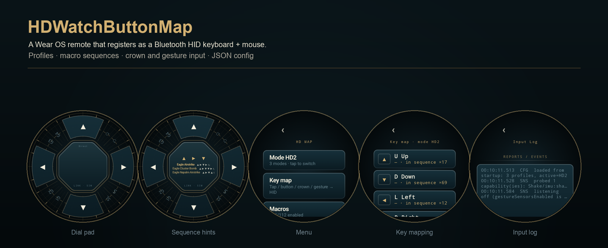
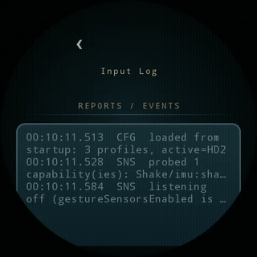

# HDWatchButtonMap



A Wear OS remote that turns a smartwatch into a programmable **Bluetooth HID
keyboard + mouse**. Two profile kinds, a dial-shaped control surface, crown and
gesture input, and a JSON config you can edit on the watch or push over adb.

Tested on Galaxy Watch6 Classic (SM-R960); **minSdk 30 (Wear OS 3.0+)** with
proportional dial scaling and OEM rotary calibration for round & square watches
(Galaxy Watch 4/5/6/7/Ultra, Pixel Watch 1/2/3, OnePlus Watch 2/3, TicWatch Pro
5, Xiaomi Watch, etc.). No host-side software, no network permission.

## Demo



*Captured on the Wear emulator with the log-only transport (the footer reads
`LINK · SIM`); on a real watch the footer shows the Bluetooth link state.*

## What it does

- **Bluetooth HID host link** — the watch registers as a keyboard + mouse +
  consumer-control device, with per-host selection and remembered preferred host.
- **Two profile kinds + on-watch presets**
  - **Direct** — every mapped input fires immediately (keys, combos, mouse
    buttons, wheel, media keys), with optional compact legends on the four arc
    keycaps.
  - **Sequence** — inputs buffer locally with a live timeout countdown arc; a
    completed sequence runs a macro of key taps, held keys, typed text, mouse
    actions and delays while the hub lists reachable macros.
  - **Built-in presets** — add *Slides · Media*, *Mouse · Nav*, or *Hotkeys*
    profiles directly on the watch from the menu.
- **Multi-watch inputs & scaling**
  - proportional dial geometry that aligns cleanly across 40mm–47mm round and
    square watch faces,
  - four arc keycaps + eight ring slots (`CW`/`CCW`, `S`/`SL`, `G1`–`G4`),
  - multi-button watch support (`STEM_1/PRIMARY` → `S`/`SL`, `STEM_2` → `G1`/`G2`,
    `STEM_3` → `G3`/`G4`),
  - rotary bezel & digital crown support with auto-detected OEM defaults,
    per-profile detent threshold, sensitivity scale, and rotary menu scrolling,
  - optional sensor gestures (wrist tilt, wrist-down, IMU shake), bindable to
    slots — off by default.
- **Hold steps** — `{"hold":"CTRL"}` latches a key (editable directly on the
  watch): first press down, next press up, with a live `HOLD` badge on the hub.
  Holds drop automatically when a sequence lands, times out, or the pad closes.
  Crown-driven latches are debounced (`rotaryLatchDebounceMs`, default 700 ms);
  wheel-mapped crowns are never debounced.
- **Key jitter** — a small randomised gap between macro key steps (default
  ≤25 ms, configurable, 0 disables); perfectly even bursts read as synthetic to
  game input handlers.
- **Three curated palettes** — *Orokin* (teal + antique gold), *Tactical*
  (obsidian + signal yellow), and *Phosphor* (pitch-black OLED + radar mint).
- **Keep-alive foreground service & pad wake-lock**, vibration master switch,
  English + Chinese resources.

## Install

Grab `app-release.apk` from the latest release and sideload it:

```bash
adb install -r app-release.apk
```

The release APK is signed with a debug keystore — this is a personal project,
not a Play Store build.

## Build & Test

```bash
./gradlew :app:testDebugUnitTest   # JVM unit tests
./gradlew :app:assembleDebug       # debug APK
./gradlew :app:assembleRelease     # debug-signed release APK
```

## Configuration

- **On the watch**: long-press the center hub → mode / presets / key map /
  macros / Bluetooth HID / settings. Profiles, themes, rotary calibration,
  gesture bindings, jitter, vibration, wake-lock and keep-alive all live there.
- **From a computer**: `adb push my.json
  /sdcard/Android/data/dev.hdwatch.buttonmap/files/hdmap.json` — imported
  automatically whenever the file is newer than the last import.
- A neutral default ships with the app; the release also carries an example
  config you can import as-is.

Config sketch:

```json
{
  "version": 2,
  "settings": { "rotateThreshold": 3, "rotaryScale": 1.0, "sequenceTimeoutMs": 3000,
                "keyJitterMs": 25, "rotaryLatchDebounceMs": 700, "theme": "orokin" },
  "activeProfile": "macro",
  "profiles": [
    {
      "id": "macro", "name": "Macros", "kind": "MACRO",
      "rotateThreshold": 1,
      "single": {
        "CCW": { "hold": "CTRL" },
        "CW":  { "mouse": { "wheel": -1 } },
        "S":   { "click": "left" }
      },
      "macros": [
        {
          "id": "paste", "name": "Paste", "seq": "D S CW", "enabled": true,
          "steps": [
            { "keydown": "CTRL" },
            { "key": "V" },
            { "keyup": "CTRL" }
          ]
        }
      ]
    }
  ]
}
```

Steps: `key` / `keydown` / `keyup` / `combo` / `hold` / `text` / `delay` /
`mouse` / `click` / `consumer`. Sequences are written with the dial symbols
`U D L R` (the four keycaps), `CW` / `CCW` (crown), `S` / `SL` (stem) and
`G1`–`G4` (bindable slots and gestures).

## 中文说明

把手表当作蓝牙 HID 键盘/鼠标用的可编程遥控器（支持 Wear OS 3.0+，自适应 40mm–47mm 圆表与方表）。

- **两种模式 + 内置预设**：直控（按下即发，支持键帽角标）与序列（本地缓冲 + 倒计时弧线，码对即触发一串动作；输入时中心牌列出还能命中的宏）；表端菜单可一键添加「演示 · 媒体」「鼠标 · 浏览」「常用热键」预设。
- **多手表适配**：按屏径等比绘制表盘与触摸域；自动识别旋转表圈/数字表冠机型并校准方向与灵敏度；支持多侧键手表（`STEM_2`/`STEM_3` 映射至 `G1`–`G4`）；菜单/长列表支持表冠滚动与懒加载。
- **三套配色 + 锁存编辑**：鎏金（Orokin）/ 战术（Tactical）/ 荧光（Phosphor）三套暗色表盘配色；表端可直接配置 `Hold` 锁存键与去抖时间；盘面默认常亮防息屏；蓝牙列表支持指定首选主机并记忆重连。
- **按键抖动 & 保活**：宏内相邻按键随机抖动（默认上限 25ms，0 关闭）；前台服务保活；振动总开关；中英双语。
- **配置**：表上直接改，或 `adb push` 一个 JSON 到应用外部目录自动导入；release 附带示例配置。

## License

No license file yet — all rights reserved by the author unless stated
otherwise.
